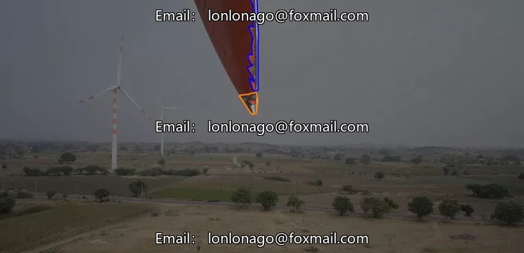
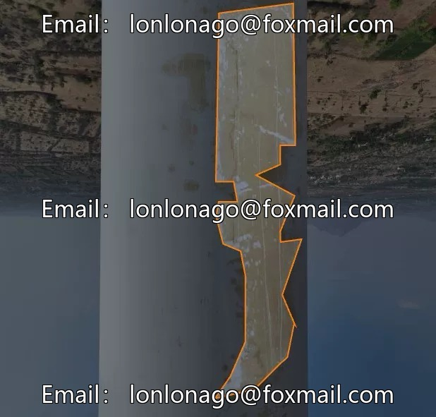
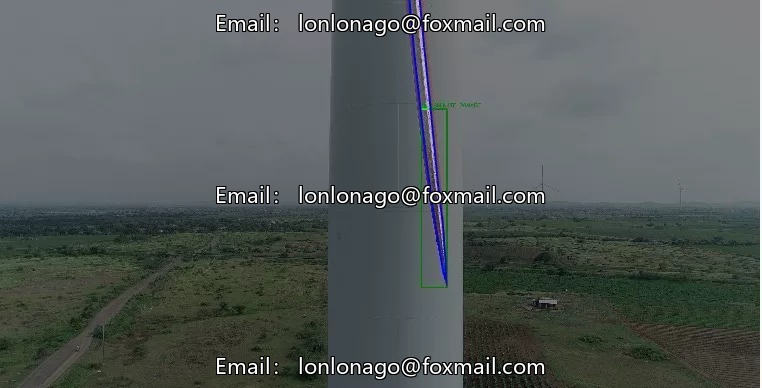
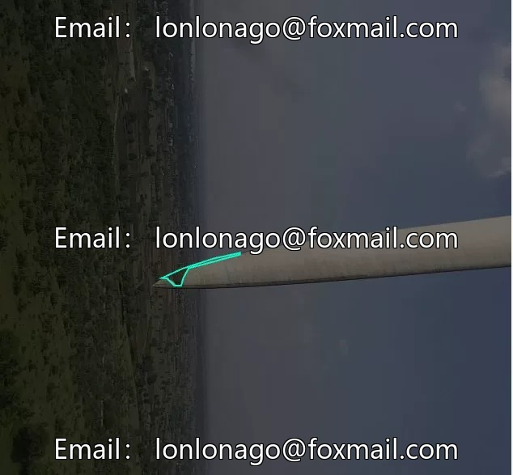

# Defective detection dataset, supporting model training

## Body

Defect Detection Dataset, Supports Model Training for Wind Turbine Blades Surface Defect Detection Dataset, Includes 8056 Images, 7 Sub-category Defect Classes
Crack (Crack), LE-Erosion (LE Erosion), LPS Burnt (LPS Burnt), Lightning-Strike (Lightning Strike), Oil Leakage (Oil Leakage), Paint Peel Off (Paint Peel Off), Surface Damage
The dataset is an instance segmentation dataset in the field of computer vision, which can be used for industrial equipment surface defect detection and maintenance.
Each category has a large amount of labeled data, supporting model training and testing.

The data format is JPG/PNG, which are common formats for computer vision. It supports image upload to test the model's effect.
The product is virtual data and once sold, it will not be returned.
It is suitable for industrial equipment inspection, maintenance, and model training research.
Interested friends can click "I want" now.

## Images

## Payment

Here is a pay link on Stripe ( https://buy.stripe.com/3cs8yP7sY87d0vu9AB ). Please contact me lonlonago@foxmail.com after funding $89, and I will send you a complete data files , thank you!

